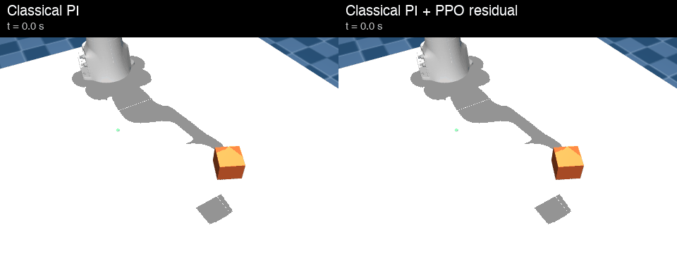

# Residual Push

A Franka Panda pushes a block to a goal on a table in MuJoCo. A classical
controller can already do the task; on top of it, a PPO policy learns a small
correction (residual RL). Training and evaluation use randomised block physics
and noisy observations, so the classical controller's model is never quite
right.



Left: classical controller. Right: classical controller plus the learned
residual (training seed 0). Both run the same held-out perturbed episode, in
real time. The episode represents the one in the first test set
whose speedup is closest to the median over all test episodes (38%). Here
that's seed 10156, with the block starting 22 cm from the goal; the residual
version finishes in 3.1 s, the classical one in 5.0 s.

## Results

### How the comparison works

Every controller is tested on the same 600 episodes, none of which were
used in training. Each episode's seed fixes where the block and goal start,
the randomised physics and the sensor noise. The episodes are split into three
groups of 200 (seeds 10000–10199, 20000–20199 and 30000–30199), and each
group is scored separately, which shows how much a result depends on which
episodes it happened to get.

That gives 3 evaluations of 200 episodes for the classical controller (one per
group) and 9 for each learned controller (3 training seeds × 3 groups). The
sweep runs twice: once with nominal physics, and once with the
randomisation in
[`configs/perturbations/eval.yaml`](configs/perturbations/eval.yaml), which
uses the same ranges as training. An episode counts as a success if the block
stays within 1 cm of the goal for 1 s, with a 20 s time limit. The learned
controllers use their final checkpoint rather than the best one seen during
training, since "best" is the highest of ~50 noisy 40-episode scores and tends
to be a lucky pick.

### Numbers

Success rate:

| Controller | Nominal | Perturbed |
|---|---|---|
| Classical PI (tuned) | 95.3% ± 1.9% | 96.7% ± 0.8% |
| Classical PI + PPO residual (3 seeds) | 99.0% ± 0.8% | 97.9% ± 1.9% |
| Pure PPO (3 seeds) | to do | to do |
| Pure PPO + curriculum (3 seeds) | to do | to do |

Steps to the goal, against the classical controller:

| Controller | Nominal steps | Nominal speedup | Perturbed steps | Perturbed speedup |
|---|---|---|---|---|
| Classical PI + PPO residual (3 seeds) | 107 → 61 ± 7 | 40% | 115 → 73 ± 12 | 38% |
| Pure PPO (3 seeds) | to do | | | |
| Pure PPO + curriculum (3 seeds) | to do | | | |

Each cell is the mean over that controller's evaluations, ± their standard
deviation. Steps are 0.05 s each and are only compared on episodes both
controllers solved (about 190 of every 200). "Speedup" is the median over those
episodes of 1 − learned steps / classical steps.

The main effect of the residual is speed: it gets the block to the goal about
40% faster. Every seed is faster on average on every episode set, by at least
24 steps, and faster on 72–99% of individual episodes. It also helps
accuracy at nominal (all 9 evaluations at 98% or above, against 94–97.5% for
the classical controller); under perturbation the two are within each other's
spread. Most of the residual's spread comes from one seed, which settled on a
slower policy (about 90 steps under perturbation, against 65 for the other two).

## How it works

### Classical controller

The pusher tip is driven by a Cartesian impedance controller (stiffness
900 N/m, damping 290 / 269 / 360 N·s/m in x / y / z), which tracks a target
position. That's heavily overdamped: with the tip's effective mass at the start
pose (about 0.8 / 0.6 / 3.9 kg) it's a damping ratio of roughly 5.5 / 5.7 / 3.
A simple pushing script in
[`controllers/classical_push.py`](controllers/classical_push.py) moves that
target around. It approaches the block from the side opposite the goal, pushes
it, and stops once the block is close enough.

While pushing, the target is set by a PI controller on the block-to-goal
error. The proportional part does most of the work; the integral term removes
the small offset left when friction stops a heavy block just short of the
goal, which the impedance controller can't correct on its own as it has no integral
term.

The gains were tuned with [`scripts/tune_classical.py`](scripts/tune_classical.py)
on 200 perturbed episodes kept separate from the test episodes (seeds
70000+): first a grid over stiffness (300–1800 N/m), damping (three Kd settings per
stiffness, between 78 and 509 N·s/m) and the integral gain, then the outer P
and I gains at the chosen stiffness and damping. Settings were ranked by
success rate first and speed second, so the controller is the fastest one that
doesn't give up reliability.

### Residual policy

The environment's action is a 3D offset for the tip target. The residual
controller adds a bounded correction to the classical action:

```text
u = u_classical + 0.1 * clip(pi(obs, u_classical), -1, 1)
```

The policy sees the normal 19-D observation plus the classical action. Its
output layer is initialised to zero, so at the start of training it behaves
exactly like the classical controller. It's trained with Stable-Baselines3 PPO
for 5M steps and the randomisation in
`train.yaml`. The pure PPO baseline uses the same environment, reward and
randomisation, but outputs the action directly. Since it has to learn the
whole task from scratch, it's also trained with a curriculum: the success zone
starts at 10 cm and shrinks by 15% whenever training success passes 70%, down
to the real 1 cm. Evaluation always uses 1 cm.

### Physics randomisation

[`envs/perturbations.py`](envs/perturbations.py) samples new block parameters
at every reset from a YAML config. Each value can be `null` (nominal), a fixed
number, or a `[lo, hi]` range.

| Parameter | Range |
|---|---|
| Block mass | 0.1 to 0.8 kg (inertia scaled to match) |
| Block-table friction | 0.2 to 0.9 |
| Pusher-block friction | 0.2 to 0.9 |
| Centre-of-mass offset | ±1.5 cm in x and y |
| Block position noise | 2 mm std |
| Block yaw noise | 0.02 rad std |
| Block velocity noise | 0.01 std |

Noise is only added to what the controller observes; reward and success are
computed from the true state. Everything is seeded, so an episode seed always
gives the same physics, start poses and noise.

## Reproducing

```bash
python3 -m venv .venv
source .venv/bin/activate
python -m pip install -r requirements.txt
```

Tuning the classical controller (the chosen gains are already the defaults in
[`envs/push_env.py`](envs/push_env.py) and
[`controllers/classical_push.py`](controllers/classical_push.py)):

```bash
python scripts/tune_classical.py
python scripts/tune_classical.py --stiffness 900 --kd 289.8,269.2,360.1 \
  --kp 0.5 1 2 3 --ki 0 0.25 0.5 1 --out logs/tune_classical_outer.json
```

Training (one residual run takes about 1.3 h on an M-series MacBook):

```bash
for s in 0 1 2; do
  python rl/train_ppo.py --mode residual --seed $s --n-envs 4 --timesteps 5000000 \
    --run-name seed$s --perturbations configs/perturbations/train.yaml
done
for s in 0 1 2; do
  python rl/train_ppo.py --mode ppo --seed $s --n-envs 4 --timesteps 5000000 \
    --run-name seed$s --perturbations configs/perturbations/train.yaml
  python rl/train_ppo.py --mode ppo --curriculum --seed $s --n-envs 4 --timesteps 5000000 \
    --run-name curriculum_seed$s --perturbations configs/perturbations/train.yaml
done
```

Evaluating every controller on the same held-out episodes (runs in parallel,
about 3 minutes):

```bash
python scripts/compare_controllers.py --sets 3 \
  --residual runs/residual/seed0 runs/residual/seed1 runs/residual/seed2 \
  --ppo runs/ppo/seed0 runs/ppo/seed1 runs/ppo/seed2 \
  --ppo-curriculum runs/ppo/curriculum_seed0 runs/ppo/curriculum_seed1 runs/ppo/curriculum_seed2
```

Watching a controller in the viewer (on macOS the passive viewer needs
`mjpython`):

```bash
mjpython scripts/eval_classical_push.py --episodes 5 --seed 10000
mjpython scripts/eval_ppo.py --run runs/residual/seed1 --checkpoint final --episodes 5 --seed 10000
```

Sweeping one parameter for the classical controller:

```bash
python scripts/sweep_classical.py --axis block_mass --values 0.1 0.3 0.5 0.8
```

## Layout

```text
assets/
  media/          README media
  meshes/         Panda visual and collision meshes
  models/         MuJoCo XML models and upstream Panda model docs
configs/
  perturbations/  nominal, train and eval randomisation configs
controllers/      impedance, classical pushing and residual controllers
envs/             Gymnasium pushing environment and physics randomisation
rl/               PPO training
scripts/          evaluation, comparison, demos and analysis
tests/            unit tests
```

## Licensing

The MuJoCo engine and the Franka Emika Panda MJCF model (including its hand and
gripper meshes) are licensed under Apache-2.0. See
[Third-party notices](THIRD_PARTY_NOTICES.md) and the model's included
[license](assets/models/LICENSE).

No project-wide license has been chosen for the original code in this
repository. The third-party licenses above apply only to their own components.
